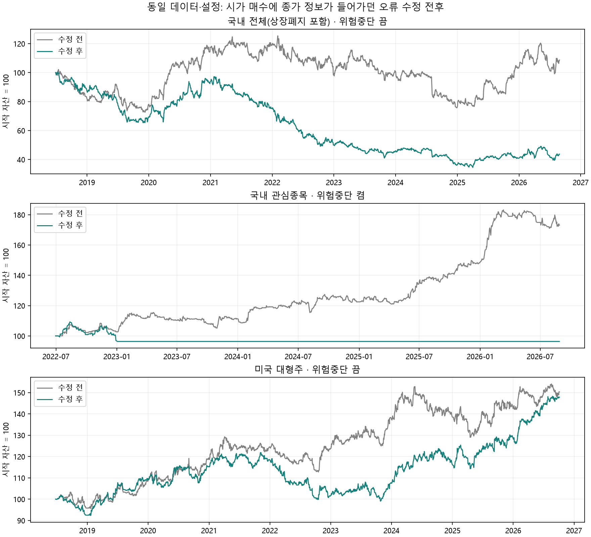

# 실행 시점 오류 수정 전후 재검증 · 2026-10-17

국내 전체 종목군의 기존 +8.6456%·1,505거래와 미국의 +50.3186%·851거래를 정확히 재현했다. 같은 데이터와 후보에서 시간 순서 오류만 수정하자 국내 전체는 −56.3260%, 미국은 +47.8525%가 됐다. 기존 전략의 우위가 확인되지 않았다는 결론은 유지되며, 국내 장기 전략 성과에 대한 평가는 더 나빠졌다. 이 값은 과거 시뮬레이션 결과이며 운영 계좌의 실제 손익이 아니다.

## 수정 전후

| 종목군·조건 | 수정 전 총수익 | 수정 후 총수익 | 수정 전 MDD | 수정 후 MDD | 거래 수 전→후 |
|---|---:|---:|---:|---:|---:|
| 국내 전체(상장폐지 포함) · 기준 | +8.65% | -56.33% | -39.62% | -65.59% | 1505→1673 |
| 국내 전체(상장폐지 포함) · 위험중단 켬 | -8.36% | -11.31% | -10.27% | -11.86% | 53→31 |
| 국내 전체(상장폐지 포함) · 7일 강제 청산 | -3.20% | -37.61% | -38.13% | -55.73% | 2253→2485 |
| 국내 전체(상장폐지 포함) · 10일 강제 청산 | +32.02% | -45.06% | -32.06% | -66.38% | 1962→2148 |
| 국내 관심종목 · 기준 | +73.11% | -3.64% | -8.94% | -11.80% | 376→66 |
| 미국 대형주 · 기준 | +50.32% | +47.85% | -15.57% | -18.70% | 851→955 |

국내 전체의 기준·보유기간 변형과 미국 기준은 위험중단을 끈 조건이다. 국내 관심종목은 위험중단을 켠 조건이다. 서로 다른 행의 결과를 종목군 차이만으로 해석하면 안 된다.

## 재현 조건과 원본 일치 여부

- 국내 전체: 2018-06-29~2026-08-28, 2,004거래일. 폐지 포함 목록 중 가격 이력 80행 초과인 2,941종목(기존 스크립트와 같은 필터). 기존 기준·7일·10일 결과 모두 소수점 네 자리와 거래 수가 일치했다.
- 미국: 2018-06-25~2026-10-05, 2,081거래일, AZN 제외 99종목. 당시 남긴 센트 단위 가격 파일 사용. 기존 수익률·MDD·거래 수·SPY 비교 p-value까지 재현했다. 원래 연구의 초기자금은 100,000,000센트($1,000,000)이며 새 운영 비교 계좌의 $100,000과 다르다.
- 국내 관심종목: 2022-06-30~2026-08-28, 1,018거래일, 102종목. 저장된 parameters.json과 현재의 나머지 설정을 사용했다. 수정 전 +73.1146%는 예전 보고서 +64.3095%(다른 보고서 +56.8131%)와 불일치한다. 따라서 이 행은 동일 입력을 사용한 현재 재현 대조실험이며 예전 보고서의 완전 재현으로 주장하지 않는다. 불완전한 설정 기록·PIT 축적·이후 공통 코드 변경 중 원인을 단정하지 않는다.
- 전후 가격·후보 캐시·설정·점수 가중치(모두 1)·비용(40bp)·시드(20260828)는 동일하다. 바뀐 것은 시가 매수 한도의 시장 상승비율을 전 거래일로 이동하고 보유자산 평가를 당일 시가로 바꾼 부분이다.
- 가격 입력 해시는 실행 전후 일치. PIT는 읽기 전용 원본에서 만든 일관된 스냅샷을 읽기 전용으로 사용했다. 외부 이름 조회를 끄고 기존 종목명을 사용했다. 운영 장부·설정·예약 작업은 변경하지 않았다.

## 지수 비교와 검정

| 실험 | 수정 전략 총수익 | 같은 구간 지수 보유 | 일평균 초과수익 %p | 양측 HAC p | 3개 기준실험 BH q |
|---|---:|---:|---:|---:|---:|
| 국내 전체(상장폐지 포함) | -56.33% | +194.01% | -0.10292 | 0.00143 | 0.00428 |
| 국내 관심종목 | -3.64% | +188.19% | -0.12624 | 0.01581 | 0.02372 |
| 미국 대형주 | +47.85% | +182.96% | -0.03711 | 0.06967 | 0.06967 |

지수 보유는 이번 공통 엔진의 첫 평가일 시가 진입·마지막 종가 평가·40bp 비용 차감·정수 수량 기준이다. 기존 미국 보고서의 SPY +182.0%는 종가 간 수익률 방식이며, 이를 유지한 보조 비교에서도 수정 전략의 초과수익은 음수(p=0.07096)다. 국내 기존 메모의 KOSPI +181%와 이번 +194.01%가 같은 정의라고 확인할 수 없으므로 섞어 쓰지 않는다. 지수 배당은 포함하지 않는다.

통계적 차이와 코드 오류는 구분한다. 수정 후−수정 전의 일별 차이를 3개 기준실험으로 BH 보정한 q는 국내 전체(상장폐지 포함) 0.06528, 국내 관심종목 0.00917, 미국 대형주 0.92490. 국내 전체의 총수익 변화는 크지만 그 전후 일별 차이를 다중검정 후 유의하다고 표현하지 않는다.

## 기존 판단의 유지 여부

- 종목 선정 우위: 국내 관심종목에서 랜덤 선택 100회씩 전후 재실행. 수정 전략 −3.64%, 수정 랜덤 중앙값 −3.45%, 총수익 우위 경험적 p=0.56436. 평균 랜덤 일수익 대비 양측 p=0.93945. 선정 우위는 확인되지 않았다. 원래 보고서의 모멘텀·동일가중·국면별 16검정 전체를 다시 실행한 것은 아니다.
- 보유기간 단축: 수정 기준 대비 hold7/hold10의 BH q는 둘 다 0.38112. 7일은 두 절반 모두 일평균 차이가 양수지만 유의성 기준을 통과하지 못했다. 10일은 후반기 차이가 음수다. 두 변형 모두 운영 반영 근거 없음이라는 기존 판단 유지.
- 위험중단: 국내 전체 위험게이트는 마지막 매수가 2018-09-21→2018-08-06으로, 관심종목은 2026-08-14→2022-12-28로 바뀐다. 낮은 MDD에 장기간 신규매수 중단이 크게 기여하므로 전략의 매매 우위로 해석할 수 없다.
- 미국: 수정 후에도 SPY 우위 증거 없음. 종목군이 현재 대형주인 생존편향 한계도 남는다.

## 원인 분리 확인

동일 국내 전체 데이터·후보·설정으로 두 변경을 각각 적용해 추가 실행했습니다.

| 적용한 수정 | 총수익 | MDD | 거래 |
|---|---:|---:|---:|
| 없음(기존 오류 포함) | +8.6456% | −39.6224% | 1,505 |
| 시장 상승비율만 전 거래일로 변경 | −56.2299% | −66.9360% | 1,704 |
| 보유자산 평가만 당일 시가로 변경 | +5.3195% | −40.5745% | 1,475 |
| 둘 다 수정 | −56.3260% | −65.5851% | 1,673 |

큰 격차의 주원인은 당일 종가로 계산한 상승비율을 이미 지난 당일 시가 매수 한도에 적용했던 부분입니다. 종가 기준 하락일에는 시가 매수를 줄이는 식으로 당시 알 수 없는 정보를 이용했습니다. 경로가 달라지므로 두 수정의 효과를 단순 합산할 수는 없습니다. 원자료: `ablation.py`, `ablation.json`, `ablation.log`.

## 범위와 다음 판단

이번 재검증은 핵심 기준 3개, 국내 위험게이트 1개, 보유기간 변형 2개와 랜덤 200회다. 기존 저변동성 제외·재진입·섹터 제한·지수 혼합·위험해제 전체 변형은 아직 수정 엔진으로 재검증하지 않았다. 해당 포트폴리오 수치들은 재검증 전 의사결정 근거로 사용하지 않는다. 개별 요인의 IC처럼 이 포트폴리오 엔진을 쓰지 않은 통계가 이번 수정으로 자동 변경되는 것은 아니다.
판단: 새 매매 규칙 추가보다 재현 가능한 기준선과 평가 정의 확정이 우선이다. 이번 결과만으로 운영 전략·계좌·학습 가중치를 자동 변경하지 않았다.

## 산출물·재실행

- `PROTOCOL.md`: 결과 계산 전 계획. `manifest.json`: 코드·PIT 스냅샷 해시.
- 각 종목군 폴더: `inputs.json`, `candidates.json`, `results.json`, 전후 일별 자산·주문 기록.
- `comparison.csv`, `equity_comparison.png`: 비교표와 그래프.
- 실행 스크립트: 저장소 `scripts/revalidate_execution_timing.py`. 실행 예: `python scripts/revalidate_execution_timing.py kr_all reports/revalidation/2026-10-17-execution-timing`.
- 재실행 전 입력 가격 해시·PIT 스냅샷·설정·공통 소스가 기록과 같은지 확인해야 한다. 현재 스크립트는 새 실행에서 현재 환경을 읽으므로 이전 inputs.json과 달라지면 같은 실험으로 간주하지 않는다.
- 전체 테스트: pytest 679개 및 하위 검사 8개 통과. 연구 원자료는 로컬 reports 폴더에 보관한다.

후속 갱신(2026-10-17): 위 미재검증 목록의 지수 혼합·위험해제·재진입·고변동성 제외·섹터 제한은 [추가 보고서](../2026-10-17-strategy-variants/REPORT.md)에서 재검증했습니다. 앞 문단은 이 기준선 보고서 작성 시점의 범위 기록입니다.
